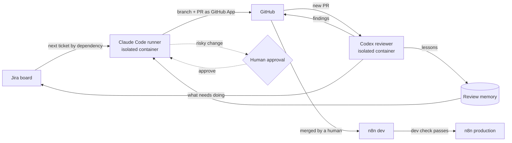

## The problem

I wanted an engineering loop I could hand a backlog to: write the ticket, and have agents build it, review it and bring it back ready to merge, without giving those agents the keys to everything. Off-the-shelf options either billed per API key, ran on someone else's infrastructure, or didn't let me control the review and approval steps. So I built it on my own hardware.

## Demo



## Architecture

Everything runs in separate containers on a Proxmox host: n8n for dev and production, PostgreSQL, Ollama for local models, the runner, and the reviewer. Each agent container is firewalled to only what it needs.

## How a ticket moves

1. A ticket on the Jira board carries its acceptance criteria, risk level and dependency links.
2. The runner picks the next ticket by walking every ticket's dependency links, with no hand-picked favorites.
3. Claude Code builds the change on a branch and opens a pull request under a GitHub App bot identity.
4. The Codex reviewer finds the pull request on GitHub, reviews it against standards and the ticket, and posts findings to both GitHub and the Jira ticket.
5. The runner fixes and resubmits. The loop stops when both agents sign off, or at 10 rounds.
6. Every review finding is written to a review memory, so the runner doesn't repeat the same mistake on the next ticket.
7. The ticket moves to Pending Approval. I review it and merge; a ticket only reaches Done after its pull request is merged.
8. Merged workflows deploy to n8n dev automatically, then promote to production once the dev check passes.

## Decisions and trade-offs

| Decision | Why | Trade-off |
|---|---|---|
| GitHub App bot identity, not a personal token | Agent actions are auditable and scoped separately from mine | More setup: app installation, key handling, token refresh |
| Codex review runs locally in its own container | Review stays on my hardware and can't touch the runner's environment | I own uptime and updates for one more service |
| Human merge gate | A merge ships code; that click stays with a person while the system matures | Throughput is bounded by my review time |
| 10-round cap on the review loop | Stops runaway build and review cycles | Some tickets stop short and need a person |
| Risk levels on every ticket | Higher risk means more testing and review, not a different process | The highest risk tier stays off-limits to the runner entirely |

## Guardrails and failure modes

- **Least privilege:** each agent gets scoped tokens, its own container, and outbound network rules limited to what it needs. The reviewer's Jira token can only do the reviewer's job.
- **Org-wide ruleset:** one GitHub ruleset applies across every repository, with no per-repo exceptions.
- **Merge rule:** nothing merges until every comment on the pull request and its tickets is resolved and every acceptance criterion is met.
- **Runaway agents:** the round cap and the human merge gate bound how far a bad loop can go.

## What I learned

- **Ticket quality is the bottleneck.** Tickets that passed through two rounds of summarization lost the detail the runner needed. Tickets have to be written from the source-of-truth plan files, not from summaries of summaries.
- **The board has to tell the truth.** A ticket marked done whose scope didn't match the real work made progress look further along than it was. Done now means merged.
- **Review memory compounds.** Saving every finding means a correction made once is available to every later run.
